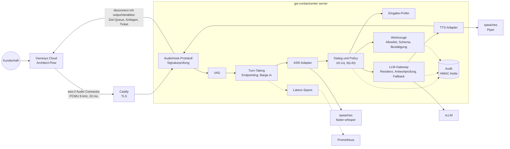

# contactcenter

Sprachagent und Kapazitätsrechner für den Kundendienst von Schweizer KMU:
Genesys Audio Connector, lokale Modelle, Leitplanken und belegte Warteschlangen-Mathematik.

## In English

This repository contains a telephone voice agent for small and medium-sized Swiss companies
that connects to Genesys Cloud via the AudioHook/Audio Connector protocol (WebSocket, PCMU),
with semantic endpointing, barge-in, an LLM gateway enforcing data-residency rules, checked
tool calls, a tamper-evident HMAC audit chain and latency telemetry. It also ships the
planning maths a contact-center project needs: Erlang-B/C/A staffing validated against
published reference values and an independent discrete-event simulation, and a GPU sizing
model derived from published model architectures and vendor datasheets. Everything runs
offline against mocks and local fake servers; latency figures are either labelled as
assumptions or simulations, or come from the included measurement tool run against real
endpoints. Documentation is in German.

## Worum es geht

Ein KMU will Anrufe teilweise automatisch beantworten: Anliegen verstehen, einfache Fälle
selbst lösen, heikle sauber an Menschen übergeben. Dieses Repo liefert dafür

- einen **lauffähigen Sprachagenten** (Paket `gw_contactcenter`, Kern nur
  Python-Standardbibliothek), der als WebSocket-Server am Genesys Audio Connector hängt,
- einen **Kapazitätsrechner** für Personal und Sprachagent-Kanäle (Erlang-B, -C, -A) und
  eine **GPU-Dimensionierung** mit offengelegtem Rechenweg,
- ein **Messwerkzeug** für die Latenz echter Modell-Endpunkte,
- **Dossiers** zu Architektur, Spracherkennung, Inferenz, Daten, Betrieb und Grenzen
  (`docs/`).

## Schnellstart (offline, ohne GPU und ohne Schlüssel)

```bash
python3 -m venv .venv && . .venv/bin/activate
pip install -e ".[dev]"
gw-contactcenter kapazitaet --anrufe-pro-tag 200   # Personal und Kanäle
gw-contactcenter gpu --modell qwen3-8b --gespraeche 10
gw-contactcenter sim                                # simulierter Anruf
pytest                                              # Tests mit Abdeckung
python evals/run_evals.py                           # Golden-Set mit Gate
```

Die Befehle laufen in der CI (`.github/workflows/ci.yml`); die Ausgaben unten werden von
`tests/test_doku_konsistenz.py` neu erzeugt und verglichen.

## Architektur



Ein Gesprächswechsel: Genesys streamt das Audio der Kundschaft; die Sprachaktivitätserkennung
markiert Sprache, das Turn-Taking entscheidet, wann die Äusserung fertig ist (kürzer bei einem
vollständigen Satz, länger beim Diktieren einer Nummer). Danach pseudonymisiert der Dialog
Personendaten, prüft die Eingabe, klassifiziert das Anliegen lokal und wendet die Policy an:
selbst lösen, mit Bestätigung lösen, aufnehmen und übergeben oder sofort übergeben. Antworten
kommen satzweise geprüft aus dem Gateway; die Sprachausgabe beginnt mit dem ersten Satz.
Unterbricht die Kundschaft, verwirft der Agent den Rest und meldet Genesys `barge_in`. Bei
einer Übergabe endet die Sitzung mit `disconnect` und Output-Variablen für den Architect-Flow.
Details: [`docs/12-zielarchitektur.md`](docs/12-zielarchitektur.md).

## Kapazitätsrechner: durchgerechnetes Beispiel

Frage aus der Praxis: «200 Anrufe pro Tag, Gesprächsdauer im Mittel 2 Minuten, wie viele
Agenten und wie viele Sprachagent-Kanäle?» Die Spitzenstunde trägt in diesem Beispiel 25 %
des Tagesvolumens. Das ist eine **Annahme** und muss durch Daten der eigenen Telefonanlage
ersetzt werden (Parameter `--spitzenanteil`).

<!-- ausgabe: gw-contactcenter kapazitaet --anrufe-pro-tag 200 -->
```text
Kapazitätsrechner (Erlang-C, M/M/n; Sprachagent: Erlang-B)
Annahmen
  Anrufe pro Tag              200
  Anteil Spitzenstunde        25 %  (Annahme, durch eigene ACD-Daten ersetzen)
  Anrufe in der Spitzenstunde 50.0
  Mittlere Bearbeitungszeit   120 s
  Angebotslast A              1.667 Erlang
Ziele
  mittlere Wartezeit (ASA) <= 20 s

Agenten  P(warten)  ASA s   SL 20 s  Auslastung
      2     75.8 %  272.7    28.3 %       83.3 %
      3     30.0 %   27.0    76.0 %       55.6 %
      4     10.2 %    5.3    93.1 %       41.7 %  <- kleinste Zahl, die alle Ziele erfüllt
      5      3.0 %    1.1    98.3 %       33.3 %

Ergebnis: 4 Agenten gleichzeitig in der Spitzenstunde (ohne Pausen und Abwesenheiten).
Sprachagent (Erlang-B): 6 Kanäle für <= 1 % Überlauf (berechnet 0.56 %).
```

Gerechnet wird mit Erlang-C: Angebotslast A = λ · h, Wartewahrscheinlichkeit C(n, A),
mittlere Wartezeit W_q = C(n, A) · h / (n − A) und Servicelevel
SL(t) = 1 − C(n, A) · e^(−(n − A) · t / h). Eine frühere Fassung dieses Repos rechnete die
Wartezeit ohne den Faktor h und kam auf 3 Agenten; richtig sind 27.0 s mittlere Wartezeit bei
3 und 5.3 s bei 4 Agenten. Ein Sprachagent, der jeden Anruf sofort annimmt, ist dagegen ein
Verlustsystem: Erlang-B liefert die Kanalzahl, ab der höchstens 1 % der Anrufe überlaufen.

Die Formeln sind gegen publizierte Referenzwerte und gegen eine unabhängige
ereignisdiskrete Simulation geprüft ([`docs/05-skalierung.md`](docs/05-skalierung.md)).
Weitere Optionen: `--ziel-servicelevel 0.8`, `--abwesenheit 0.3` (Pausen, Schulung,
Krankheit) und `--geduld-s 60` (Erlang-A mit Abbrüchen).

Die GPU für diese Kanäle rechnet `gw-contactcenter gpu` aus Modellarchitektur und
Datenblatt; Ergebnis und Annahmen stehen in
[`docs/11-performance-architektur.md`](docs/11-performance-architektur.md). Es sind
Obergrenzen, keine Messungen.

## Latenz: Budget, Simulation, Messung

Für die Zeit vom Ende der Kundenäusserung bis zum ersten hörbaren Ton gibt es hier drei
Arten von Zahlen, die nicht verwechselt werden dürfen:

| Art | Was es ist | Wo |
|---|---|---|
| **Budget (Annahme)** | Zielwerte pro Stufe, z. B. 1000 ms bis zum ersten Ton, davon 400 ms Endpointing | `gw_contactcenter/telemetry.py` (`ZIELBUDGET_MS`) |
| **Simulation** | Ganze Anrufe auf simulierter Uhr. Nur das Endpointing bestimmt der Algorithmus; ASR, LLM und TTS sind Mock-Komponenten mit fest eingestellten Verzögerungen. Zeigt das Zusammenspiel der Stufen, nicht die Geschwindigkeit echter Modelle. | `gw-contactcenter sim`, [`docs/15-latenz.md`](docs/15-latenz.md) |
| **Messung** | Echte Endpunkte (vLLM, speaches oder andere OpenAI-kompatible Dienste) mit Wiederholungen, Perzentilen, Datum und Hardware-Angabe | `gw-contactcenter latenz-messen` |

In der Simulation erreicht der Demo-Anruf das Budget nur, wenn die Spracherkennung schon
während des Sprechens Zwischenergebnisse liefert (Zeit bis zum ersten Ton p50 690 ms). Der
mitgelieferte HTTP-Adapter liefert keine; das Endpointing wartet dann länger, und die
Simulation liegt mit p50 1090 ms über dem Budget. Ein Streaming-ASR-Adapter steht in der
[`ROADMAP.md`](ROADMAP.md).

Dieses Repo enthält **keine Messergebnisse**: Sie hängen von Hardware, Modell und Last ab und
entstehen erst, wenn das Messwerkzeug gegen die Zielumgebung läuft. Methode und Aufruf:
[`docs/15-latenz.md`](docs/15-latenz.md).

## Leitplanken

- **Datenresidenz**: Datenklasse V2-V4 nur auf lokalen Modellen; die erste Klassifikation
  läuft immer lokal.
- **Personendaten**: IBAN (mod 97), Kartennummern (Luhn) und AHV-Nummern (EAN-13) werden vor
  dem Modell pseudonymisiert; Antworten mit gültigen Nummern werden ersetzt.
- **Werkzeuge**: Allowlist pro Anliegen, Schema, Bestätigung bei Wirkung, Idempotenz.
- **Eingabe- und Antwortprüfer**: Die mitgelieferten Regex-Listen sind eine erste Schicht.
  Auf einem Holdout-Set (vor der Messung geschrieben, nie zum Tunen verwendet) erkennen sie
  5 von 30 Angriffen und markieren 0 von 30 harmlosen Aussagen fälschlich. Stärkere Prüfer
  (Klassifikator, Sprachmodell) lassen sich über die Schnittstelle `Pruefer` einstecken.
- **Audit**: HMAC-Hash-Kette, Schlüssel ausserhalb des Entwicklungsmodus Pflicht.
- **Telefonie**: Prüfung der HTTP-Nachrichtensignatur von Genesys beim Verbindungsaufbau.

Details und Messung: [`docs/16-leitplanken.md`](docs/16-leitplanken.md). Für beaufsichtigte
Finanzinstitute ist zusätzlich die FINMA-Aufsichtsmitteilung 08/2024 «Governance und
Risikomanagement beim Einsatz Künstlicher Intelligenz» massgebend; dieses Repo erfüllt sie
nicht von sich aus.

## Betrieb mit Docker Compose

`deploy/compose.yaml` beschreibt einen Server mit einer GPU: Caddy (TLS), der Agent, vLLM,
speaches (ASR und TTS) und optional Prometheus/Grafana.

```bash
cp deploy/.env.example deploy/.env      # Pflichtwerte setzen
docker compose -f deploy/compose.yaml --env-file deploy/.env up -d
```

- Der Agent startet im Modus `produktion` nur mit API-Key, Client Secret (Signaturprüfung),
  Audit-Schlüssel, Audit-Verzeichnis und echten Modell-Endpunkten.
- Kein Container läuft als root; Ports binden standardmässig an 127.0.0.1. Für Genesys muss
  Port 443 bewusst öffentlich gemacht werden (`PUBLIC_BIND_ADDR=0.0.0.0`).
- Images haben feste Versionen; vor Produktion zusätzlich auf Digest pinnen.
- Die Compose-Datei ist mit `docker compose config` und Richtlinientests geprüft, aber nicht
  auf GPU-Hardware gelaufen.

Betrieb, Überwachung und Störungen: [`docs/10-betrieb-ops.md`](docs/10-betrieb-ops.md).

## Dokumentation

| Dossier | Inhalt |
|---|---|
| [00 Unterfangen](docs/00-unterfangen.md) | Ausgangslage, Facetten, Lesereihenfolge |
| [01 Architektur](docs/01-architektur.md) | Bausteine und Datenfluss |
| [02 Entscheidsmatrix](docs/02-entscheidsmatrix.md) | Welche Frage wo beantwortet wird |
| [03 ASR](docs/03-asr-transkribation.md) | Spracherkennung, Schweizerdeutsch |
| [04 Inferenz](docs/04-vllm-inferenz.md) | vLLM und Konfiguration |
| [05 Skalierung](docs/05-skalierung.md) | Erlang-B/C/A, Validierung |
| [06 Daten](docs/06-daten-speicherung.md) | Datenklassen, Speicherbedarf |
| [07 Weiterleitung](docs/07-weiterleitung-handoff.md) | Anliegen-Katalog, Übergabe |
| [08 Projekt](docs/08-projekt-aufwand-kosten.md) | Vorgehen und Kostentreiber |
| [09 Rollen](docs/09-skill-wissen-schulung.md) | Rollen und Kompetenzen |
| [10 Betrieb](docs/10-betrieb-ops.md) | Überwachung, Störungen, Audit |
| [11 GPU](docs/11-performance-architektur.md) | Dimensionierung mit Rechenweg |
| [12 Zielarchitektur](docs/12-zielarchitektur.md) | Der Sprachagent im Detail |
| [13 Technologien](docs/13-technologien-erklaert.md) | Begriffe und Rollen |
| [14 Full-Duplex](docs/14-dessa-und-full-duplex.md) | Speech-to-Speech-Modelle |
| [15 Latenz](docs/15-latenz.md) | Budget, Simulation, Messung |
| [16 Leitplanken](docs/16-leitplanken.md) | Schichten, Holdout-Messung, Audit |

## Grenzen

- **Telefonie nur über Genesys.** Für SIP-Trunks, Asterisk oder andere Plattformen braucht es
  einen weiteren Protokoll-Adapter. Die Audio-Connector-Erweiterungen (`barge_in`, `dtmf`,
  `playback_*`) sind nicht gegen die Genesys AudioHook Test Suite geprüft.
- **Keine gemessenen Latenzen und keine Lasttests auf GPU-Hardware** im Repo. Mit dem
  mitgelieferten ASR-Adapter ohne Zwischenergebnisse verfehlt schon die Simulation das
  Latenzbudget.
- **Evals offline prüfen die Verdrahtung, nicht die Modellqualität.** Das Golden-Set hat
  20 Fälle mit einem Regel-Modell; die Qualität eines echten Modells zeigt erst
  `python evals/run_evals.py --llm-url ...` mit eigenen, anonymisierten Fällen.
- **Die Regex-Prüfer sind schwach** (Holdout oben). Ohne stärkere Schicht verlässt sich der
  Schutz vor Manipulation auf die Architektur: keine Schreibrechte ohne Werkzeug und
  Bestätigung, keine heiklen Daten in der Cloud.
- **Schweizerdeutsch** bleibt für die Spracherkennung schwierig
  ([`docs/03-asr-transkribation.md`](docs/03-asr-transkribation.md)).
- **Erlang-Modelle setzen Poisson-Ankünfte und (bei Erlang-C) exponentielle
  Bearbeitungszeiten voraus**; die Spitzenstunden-Annahme ist ein Parameter, kein Fakt.
- **Kein Rechtsrat.** Das Repo zeigt, wo Daten verarbeitet werden; ob das zulässig ist
  (revDSG, Branchenrecht, EU AI Act bei EU-Bezug), klärt der Betreiber mit Fachleuten.
- **Wissensbasis und CRM sind Demo-Objekte** (`DemoBackend`); echte Anbindungen sind
  Projektarbeit.

## Entwicklung

```bash
pip install -e ".[dev]"
ruff check . && ruff format --check . && mypy && pytest
```

Beiträge: [`CONTRIBUTING.md`](CONTRIBUTING.md). Sicherheitslücken: [`SECURITY.md`](SECURITY.md).
Änderungen: [`CHANGELOG.md`](CHANGELOG.md). Geplantes: [`ROADMAP.md`](ROADMAP.md).

## Lizenz und Kontakt

MIT-Lizenz ([`LICENSE`](LICENSE)), © 2026 GRADweight GmbH.
Beratung, Einführung und Support: mail@gradweight.ch
