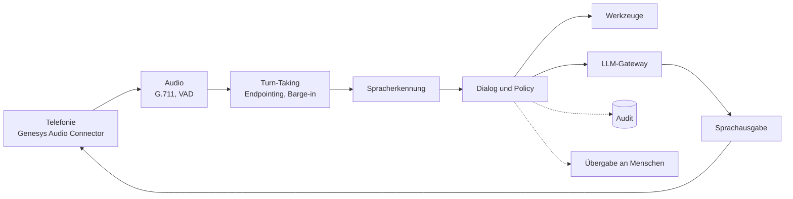

# 01 Architektur: Bausteine und Datenfluss

## Überblick

Ein Telefonat durchläuft eine Kette. Jede Stufe hat eine kleine Schnittstelle; Modelle und
Dienste hängen über Adapter an und lassen sich tauschen, ohne die Logik zu ändern.

| Baustein | Aufgabe | Modul |
|---|---|---|
| Telefonie | WebSocket-Protokoll mit Genesys, Signaturprüfung, Übergabe per `disconnect` | `audiohook.py`, `signatur.py`, `server.py` |
| Audio | G.711 mu-law, Resampling, Pegel | `audio.py` |
| Sprachaktivität | Sprache oder Stille pro 20 ms | `vad.py`, `adapters/silero.py` |
| Turn-Taking | Wann ist die Äusserung fertig, wann unterbricht jemand | `turn.py` |
| Spracherkennung | Ton zu Text (OpenAI-kompatibler Dienst) | `adapters/openai_compat.py` |
| Dialog und Policy | Anliegen, Datenklasse, Risiko, Ablauf, Übergabe | `dialog.py`, `policy.py` |
| Leitplanken | Personendaten, Eingabe- und Antwortprüfer | `pii.py`, `leitplanken.py` |
| LLM-Gateway | Datenresidenz, Fallback, Budget, satzweises Streaming | `gateway.py` |
| Werkzeuge | Allowlist, Schema, Bestätigung, Idempotenz | `tools.py` |
| Sprachausgabe | Text zu Ton | `adapters/openai_compat.py` |
| Audit | Hash-Kette mit HMAC | `audit.py` |
| Telemetrie | Latenz-Spans, Prometheus | `telemetry.py` |

## Grundsätze im Code

1. **Ein Weg zu jedem Modell.** Dialog und Werkzeuge rufen nie direkt ein Modell auf,
   sondern das Gateway. Dort gelten Datenresidenz, Antwortprüfung, Fallback und Budget.
2. **Kein Schreibzugriff ohne Werkzeug.** Was etwas verändert (z. B. ein Ticket), läuft über
   ein Werkzeug mit Schema; ab Risikoklasse R1 erst nach ausdrücklichem «Ja».
3. **Klassifikation zuerst lokal.** Bevor das Anliegen bekannt ist, weiss niemand, wie heikel
   der Inhalt ist; deshalb läuft die erste Einordnung auf einem lokalen Modell, und Regeln
   können das Ergebnis des Modells nur verschärfen.
4. **Ausfall heisst Übergabe, nicht Stille.** Fällt ein Modell, die Spracherkennung oder die
   Sprachausgabe aus, übergibt der Agent an einen Menschen.
5. **Nachweisbar.** Entscheidungen (Anliegen, Modell, Region, Werkzeug, Übergabegrund) landen
   pseudonymisiert im Audit; Latenzen als Spans.

## Andere Kanäle

Der Dialog arbeitet mit Text. Chat oder E-Mail können `Dialog.wechsel()` direkt nutzen;
Spracherkennung, Turn-Taking und Sprachausgabe entfallen dann. Ein Adapter für diese Kanäle
ist nicht Teil des Repos.

## OpenAI-kompatible Schnittstelle

LLM, Spracherkennung und Sprachausgabe werden über die verbreitete OpenAI-kompatible HTTP-API
angesprochen (`/v1/chat/completions`, `/v1/audio/transcriptions`, `/v1/audio/speech`). vLLM
und speaches bieten diese Endpunkte an. Ein Anbieterwechsel ist damit eine Änderung der
Konfiguration; ob ein anderes Modell gleich gut arbeitet, zeigen erst die Evals.

## Grenzen

- Nur Genesys als Telefonie; kein SIP-Adapter.
- Die Spracherkennung arbeitet pro Äusserung (keine Zwischenergebnisse); das verlängert das
  Endpointing ([15](15-latenz.md)).
- Keine Wissensbasis mit Vektorsuche; `wissen_suchen` ist ein Platzhalter.

## Kritische Fragen

| # | Frage | Warum |
|---|---|---|
| 1 | Welche Systeme braucht der Agent (Shop, CRM, Kalender) und mit welchen Rechten? | Jedes Werkzeug ist Angriffsfläche; nur das Nötigste freigeben. |
| 2 | Wo läuft das Modell für welche Datenklasse? | Bestimmt Hardware und Verträge. |
| 3 | Was passiert bei einem Ausfall ausserhalb der Bürozeiten? | Übergabe braucht eine erreichbare Warteschlange. |
