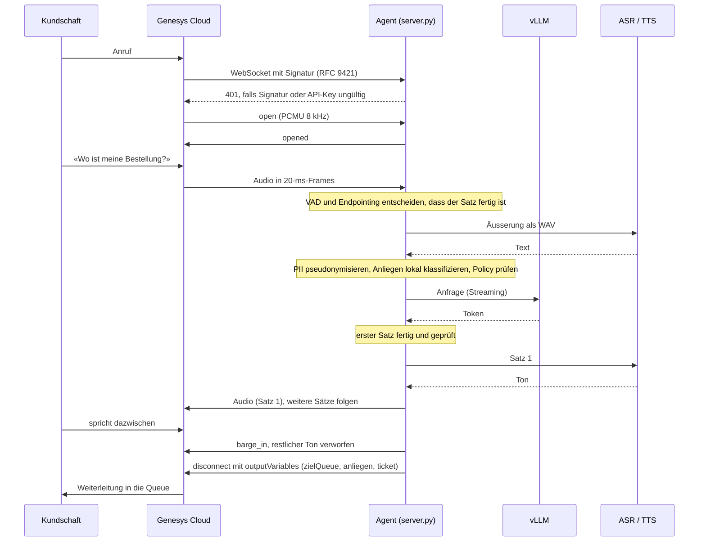

# 12 Zielarchitektur: Der Sprachagent am Genesys Audio Connector

[01](01-architektur.md) beschreibt die Bausteine. Dieses Dossier zeigt, wie ein Anruf durch
das System läuft, wie die Anbindung an Genesys Cloud aussieht und welche Teile des
Protokolls belegt beziehungsweise noch ungeprüft sind.

## Ein Gesprächswechsel

Schritte, die im Code nachvollziehbar sind:

1. **Verbindungsaufbau** (`server.py`, `signatur.py`): Pflicht-Header, API-Key und
   HTTP-Nachrichtensignatur (RFC 9421, HMAC-SHA256 mit dem Client Secret) samt Zeitfenster und
   Schutz gegen wiederverwendete Nonces. Bei Fehlern HTTP 401, bei voller Kapazität 503.
2. **Protokoll** (`audiohook.py`): Zustandsmaschine ohne Netzwerk; prüft Sequenznummern und
   Sitzungs-ID und beendet bei Verstössen mit `disconnect` (`reason: error`).
3. **Turn-Taking** (`vad.py`, `turn.py`): Sprachaktivität pro 20 ms, Satzende-Schätzung,
   Barge-in und Rückmeldelaute («mhm») werden unterschieden.
4. **Dialog** (`dialog.py`, `policy.py`, `tools.py`): Pseudonymisierung, Klassifikation auf
   einem lokalen Modell, Policy nach Daten- und Risikoklasse, Werkzeuge mit Bestätigung.
5. **Gateway** (`gateway.py`): Modellwahl nach Region, satzweises Streaming, Prüfung jedes
   Satzes, Fallback und Budget.
6. **Ausgabe** (`pipeline.py`, `server.py`): TTS pro Satz, Versand in 20-ms-Frames gegen feste
   Fristen; bei Barge-in verwirft der Sender alle noch nicht gesendeten Frames.
7. **Übergabe**: `disconnect` mit `outputVariables`; im Fehlerfall Notfall-Ansage und Übergabe.

## Anbindung in Genesys Cloud

- Integration «Audio Connector» mit der `wss://`-Adresse des Agenten und den Zugangsdaten
  (API-Key, Client Secret).
- Im Architect-Flow (Inbound-, Outbound- oder In-Queue-Anrufflow) die Aktion «Call Audio
  Connector» aus der Kategorie «Bot». Eingabevariablen gehen im `open` mit, Ausgabevariablen
  werden nach erfolgreichem Abschluss der Bot-Sitzung gesetzt.
- Der Erfolgspfad der Aktion routet nach `zielQueue`; ein Fehlerpfad (Agent nicht erreichbar,
  503, Zeitüberschreitung) muss in die normale Queue führen.

Quellen: Genesys-Referenzimplementierung für AudioHook
(github.com/purecloudlabs/audiohook-reference-implementation), Genesys-Hilfeartikel zu
Ausgabevariablen der Aktion «Call Audio Connector», öffentliche Integrationsanleitungen von
Bot-Anbietern.

## Was belegt ist und was nicht

| Teil | Stand |
|---|---|
| Nachrichtenformat, Sequenzregeln, `disconnect`-Gründe, `paused`/`resumed`, `close`/`closed` | nach der Genesys-Referenzimplementierung; Tests in `tests/test_audiohook.py` |
| Signaturprüfung (RFC 9421, abgedeckte Komponenten, Zeitfenster) | nach der Referenzimplementierung; Tests mit selbst signierten Anfragen in `tests/test_signatur.py` |
| `inputVariables`, `outputVariables`, `barge_in`, `dtmf`, `playback_*` (Audio-Connector-Erweiterungen) | aus Hilfeartikeln, Community-Beiträgen und Integrationen anderer Anbieter; **nicht** gegen die Genesys AudioHook Test Suite oder eine echte Org geprüft |
| Verhalten unter Last mit echter Telefonie | nicht geprüft |

## Ausbaustufen

| Stufe | Gleichzeitige Gespräche | Hardware | Betrieb |
|---|---|---|---|
| Labor | 1-2 | Arbeitsplatzrechner, Mock-Adapter oder kleines Modell | `GW_MODUS=entwicklung`, keine echten Anrufe |
| Pilot | aus Erlang-B ([05](05-skalierung.md)) | aus `gw-contactcenter gpu` ([11](11-performance-architektur.md)), danach gemessen | Compose auf einem Server |
| Ausbau | mehr Kanäle oder mehrere Instanzen | mehrere GPUs oder Instanzen | Lastverteilung, Überwachung, Bereitschaft ([10](10-betrieb-ops.md)) |

Mehrere Agent-Instanzen sind möglich, weil jede Sitzung in einer Instanz bleibt. Circuit
Breaker und Kostenzähler gelten dann pro Instanz.

## Regulatorischer Rahmen

Für Finanzinstitute unter Aufsicht der FINMA ist die Aufsichtsmitteilung 08/2024
«Governance und Risikomanagement beim Einsatz Künstlicher Intelligenz» vom 18. Dezember 2024
einschlägig. Sie behandelt Governance, Inventar und Risikoklassifizierung, Datenqualität,
Tests und laufende Überwachung, Dokumentation, Erklärbarkeit und unabhängige Überprüfung. Das
Repo liefert dafür Bausteine (Risikoklassen pro Anliegen, Golden-Set mit Gate, Audit,
Metriken), erfüllt die Anforderungen aber nicht von sich aus. Kein Rechtsrat.

## Grenzen

- Nur Genesys Cloud; kein SIP-Adapter.
- Ein Backend pro Server-Konfiguration; mehrere Backends (z. B. lokal und EU) sind im Gateway
  vorgesehen, aber nicht über Umgebungsvariablen konfigurierbar.
- Keine Wissensbasis mit Vektorsuche.

## Kritische Fragen

| # | Frage | Warum |
|---|---|---|
| 1 | Gibt es eine Genesys-Test-Org für Integrationstests? | Die Audio-Connector-Erweiterungen sind nur dort prüfbar. |
| 2 | Wohin führt der Fehlerpfad der Aktion «Call Audio Connector»? | Bei Ausfall des Agenten müssen Anrufe weiterhin Menschen erreichen. |
| 3 | Wie erreicht Genesys den Agenten (öffentliche Adresse, TLS-Zertifikat, Firewall)? | Der Agent muss aus der Genesys-Cloud-Region erreichbar sein. |
