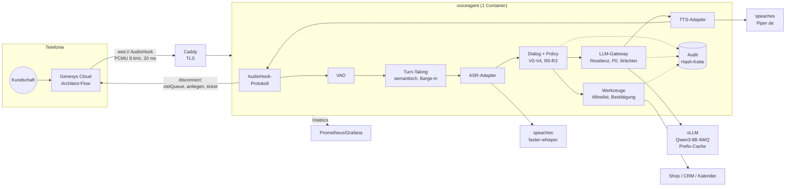

# 12 - Zielarchitektur v2: Bank-Prinzipien, KMU-Massstab

> **Stand: Oktober 2026.** Diese Doku beschreibt die lauffähige
> Implementierung in `voiceagent/`. Modell- und Image-Versionen wandern;
> vor jedem Deployment prüfen. Kein Rechtsrat, keine Offerte.

## 1. Die kurze Antwort

Version 1 dieses Repos war ein Referenzwerk mit Rechenbeispielen. Version 2
ist ein **lauffähiger Sprachagent**, der echte Telefonie spricht (Genesys
Audio Connector), Modelle lokal betreibt und dieselben Leitplanken hat, die
eine Schweizer Bank verlangen würde, nur ohne Konzern-Overhead.

| | v1 (Referenzwerk) | v2 (dieses Dokument) |
|---|---|---|
| Telefonie | beschrieben | **Genesys AudioHook/Audio Connector implementiert** (WebSocket, PCMU, Barge-in, Disconnect mit Output-Variablen) |
| Turn-Taking | nicht vorhanden | **semantisches Endpointing**, Barge-in, Backchannel-Erkennung |
| Latenz | geschätzt (805 ms, ohne Endpointing) | **gemessen im Simulator**, pro Stufe, p50/p95, mit Budget-Gate |
| LLM-Zugang | direkt | **LLM-Gateway**: Datenresidenz, PII-Tresor, Injection-Schutz, Antwort-Wächter, Fallback, Budget |
| Aktionen | Routing-Tabelle | **Werkzeuge** mit Schema, Allowlist, Bestätigung, Idempotenz |
| Nachweis | keiner | **Audit-Hash-Kette** (manipulationssicher, optional HMAC) |
| Qualität | 11 Logik-Tests | **70 Tests + 20-Fall-Eval mit Gate** (Sicherheit 100 %) |
| GPU | 1x A100 80 GB (~2'600 CHF/Mo) | **1x L4 24 GB (~700 CHF/Mo)**, aus KV-Cache und Bandbreite gerechnet |
| Betrieb | beschrieben | **Docker Compose**: Caddy (TLS), voiceagent, vLLM, speaches, Prometheus |

## 2. Vom Bank-Bild (10/10) zum KMU (11/10)

Eine Bank würde dieses System mit Kafka, Kubernetes, Feature Store und
Architekturboard bauen. Das KMU braucht nicht die Werkzeuge, aber **alle
Prinzipien**. Die "11" kommt daher, dass das KMU dieselben Prinzipien mit
einem Bruchteil der Teile umsetzt und sie trotzdem testbar macht.

| Prinzip | Bank-Umsetzung | KMU-Umsetzung hier | Datei |
|---|---|---|---|
| Ein Weg zu jedem Modell | zentrales LLM-Gateway (Plattform-Team) | Gateway-Klasse im Prozess | `gateway.py` |
| Datenresidenz per Datenklasse | AWS Zürich + OnPrem, Cross-Region gesperrt | V0 überall, V1 bis EU, **V2-V4 nur lokal** | `policy.py` |
| Klassifikation vor Inhalt | Datenklassifizierung im Ingest | **Erste Klassifikation immer lokal**, Hochwassermarke | `dialog.py` |
| PII nie ins Modell | Tokenisierung, Schlüssel im HSM | **PII-Tresor** mit Prüfsummen (IBAN, Karte, AHV) | `gateway.py` |
| Aktionen nur über APIs | API-Schicht, Least Privilege | **Werkzeug-Allowlist pro Anliegen**, Bestätigung ab R1 | `tools.py` |
| Mensch im Kreis | FINMA 08/2024, 4-Augen | **R0-R3**: selbst / bestätigen / aufnehmen / sofort übergeben | `policy.py` |
| Revisionssicherheit | WORM-Speicher, SIEM | **Hash-Kette** + WORM-fähiges Volume | `audit.py` |
| Messen statt glauben | Model Risk Management, Eval-Pipeline | **Golden-Set + Gate in der CI** | `evals/` |
| Echtzeit getrennt von Batch | Kafka/EventBridge | Audio-Pfad synchron, Audit/Tickets asynchron vorbereitet | `pipeline.py` |
| Ausfall = Mensch, nie Stille | degradierter Betrieb, Fallback-IVR | **Circuit Breaker, Fallback-Kette, Notfall-Übergabe** | `gateway.py`, `pipeline.py` |

## 3. Die Architektur

Ein Gesprächswechsel, Schritt für Schritt:

1. Genesys streamt das Audio der Kundschaft in 20-ms-Paketen (mu-law).
2. **VAD** markiert jedes Paket als Sprache oder Stille.
3. **Turn-Taking** entscheidet, wann die Äusserung fertig ist. Bei "Wo ist
   meine Bestellung?" nach ~300 ms Stille, bei "Die Nummer ist 447 ..."
   erst nach ~900 ms (Denkpause beim Diktieren).
4. **ASR** liefert den Text. **Dialog** pseudonymisiert, klassifiziert
   (lokal), prüft die Policy und ruft Werkzeuge auf.
5. Das **Gateway** wählt ein zulässiges Modell, streamt die Antwort
   **satzweise** und prüft jeden Satz. **TTS** beginnt mit Satz 1.
6. Redet die Kundschaft hinein, **verwirft** die Pipeline den Rest,
   meldet Genesys `barge_in` und speichert nur, was gesagt wurde.
7. Bei Übergabe beendet der Bot mit `disconnect` und gibt Ziel-Queue,
   Anliegen und Ticketnummer an den Architect-Flow zurück.

## 4. Latenz: gemessen, nicht geschätzt

`python -m voiceagent.sim` spielt ganze Anrufe Frame für Frame durch.
Die Adapter verbrauchen simulierte Zeit in realistischen Grössenordnungen
für eine lokale GPU. Ergebnis (Demo-Anruf):

| Stufe | p50 | Budget | Hebel |
|---|---:|---:|---|
| Endpointing (Stille bis "fertig") | 360 ms | 400 ms | semantisch statt fester 800 ms |
| ASR final | 120 ms | 200 ms | Streaming-ASR, Grossteil schon erkannt |
| LLM erstes Token | 110 ms | 250 ms | Prefix-Cache, Thinking aus, kleines Modell |
| bis erster Satz | 105-165 ms | 250 ms | kurze Sätze per Prompt |
| TTS erstes Audio | 120 ms | 200 ms | satzweise, Streaming-TTS |
| **Zeit bis erster Ton** | **~700 ms** | **1'000 ms** | Summe; Vorlagen-Antworten sind schneller |

Die Simulation beweist die *Architektur* (nichts addiert sich unnötig).
Die echten Werte pro Kunde misst man mit denselben Spans im Server
(`/metrics`) und mit 30-50 echten Testanrufen.

## 5. Ausbaustufen

| Stufe | Gleichzeitig | Hardware (aus `voiceagent.sizing`) | ~CHF/Mo | Betrieb |
|---|---|---|---:|---|
| **S** PoC | 1-3 | Mac Studio/MacBook M4 Max (llama.cpp/MLX) oder 1x L4 | 200-700 | Compose, 8 h |
| **M** Standard | bis ~10 | **1x L4 24 GB**, Qwen3-8B AWQ, ASR/TTS auf CPU oder zweiter L4 | 700-1'400 | Compose, 8 h + KI-Owner |
| **L** gross | 30-50 | 1x A100/H100 oder 2x RTX PRO 6000, 32 B möglich | 2'600-3'800 | k3s, Autoscaling auf `voiceagent_aktive_sitzungen`, N+1 |

Rechnen statt raten: `python -m voiceagent.sizing qwen3-8b 10`.

## 6. Was in v1 fachlich falsch war (und korrigiert ist)

| # | v1 | Korrektur | Wirkung |
|---|---|---|---|
| 1 | 1x A100 80 GB für 10 Anrufe | KV-Cache + Duty Cycle gerechnet: **1x L4** | ~1'900 CHF/Mo weniger |
| 2 | Ton 16 kHz/16 bit mono | Telefonie ist **G.711 8 kHz**, Kunde + Agent getrennt (Stereo) | 366 statt 732 MB/Tag; Archiv als Opus ~1/4 |
| 3 | Latenz ohne Endpointing | **Endpointing ist der grösste Posten**, jetzt gemessen | realistische 0.7-0.9 s statt geschönter Summe |
| 4 | Ziel 1'500 ms | **1'000 ms**; Menschen machen ~200 ms Pause | Bot wirkt nicht träge |
| 5 | "10 zugleich = 10 LLM-Streams" | LLM rechnet nur ~20 % der Gesprächszeit | 2 statt 10 parallele Anfragen |
| 6 | Gipfelstunde 5 Anrufe/h (OFFENE_PUNKTE #3) | 200 x 0.25 = **50 Anrufe/h** | konsistent mit Doku 05/11 |

## 7. Grenzen (ehrlich)

- **Nur Genesys ist als Telefonie umgesetzt.** Für KMU ohne Genesys
  (SIP-Trunk eines CH-Providers, Asterisk, Twilio, LiveKit SIP) braucht es
  einen weiteren Protokoll-Adapter; die Pipeline bleibt gleich.
- **Signaturprüfung der AudioHook-Requests** ist nur als API-Key-Prüfung
  umgesetzt. Vor Produktion HTTP Message Signatures gemäss Genesys-
  Spezifikation ergänzen und die Genesys AudioHook Test Suite laufen lassen.
- **ASR liefert im HTTP-Adapter keine Zwischenergebnisse.** Ohne Partials
  wartet das Endpointing konservativ (~700 ms). Mit einem Streaming-ASR
  sinkt das auf ~300 ms.
- **Die Evals laufen offline gegen ein Regel-Modell.** 100 % dort heisst:
  Policy, Werkzeuge, Sicherheit sind korrekt verdrahtet. Wie gut ein echtes
  Modell klassifiziert, zeigt erst `--llm-url`.
- **Kein RAG mit Vektor-DB** im Code; `wissen_suchen` ist ein Platzhalter.
  Für echte Wissensbasen: Postgres + pgvector, Permission-aware.
- **Schweizerdeutsch** bleibt der härteste Punkt (s. Doku 03, 13).

## 8. Kritische Fragen

| # | Frage | Warum |
|---|---|---|
| 1 | Läuft die Telefonie über Genesys Cloud oder einen SIP-Trunk? | Bestimmt den Protokoll-Adapter; Audio Connector geht nicht mit BYOC Premises. |
| 2 | Welche Anliegen darf der Bot selbst lösen (R0/R1)? | Ohne diese Liste ist jede Automatisierung ein Risiko. |
| 3 | Welche Systeme braucht er (Shop, CRM, Kalender) und mit welchen Rechten? | Jedes Werkzeug ist eine Angriffsfläche; Least Privilege. |
| 4 | Wie hoch ist der Dialektanteil? | Entscheidet zwischen Standard-Whisper und feingetuntem Modell. |
| 5 | Wer pflegt das Golden-Set, und läuft es vor jedem Modellwechsel? | Ohne Evals merkt man Verschlechterungen erst an Beschwerden. |
