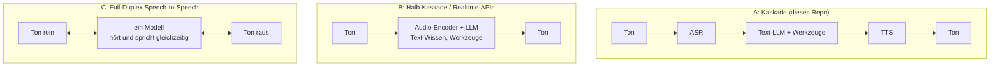
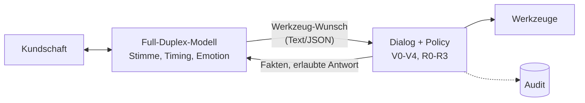

# 14 - Dessa (Block) und Full-Duplex-Sprachmodelle: was anders ist

> **Stand: 26. Oktober 2026.** Dessa wurde Ende Oktober 2026 vorgestellt
> (Presseberichte ab 24.10.) und ist **nicht öffentlich verfügbar**. Alle Angaben stammen
> aus Block-Aussagen und Presseberichten, nicht aus eigenen Tests.

## 1. Was Dessa ist

Dessa ist ein Sprachmodell aus einem kleinen Forschungslabor von Block
(Square, Cash App). Nach Block-Angaben ([TechCrunch][tc], [MindStudio][ms]):

- **Speech-to-Speech**: Audio rein, Audio raus. Kein Zwischenschritt über Text.
- **Full-Duplex**: hört und spricht gleichzeitig, kann "ja", "mhm" einwerfen,
  mitten im Satz lachen und an natürlichen Stellen einsetzen.
- **Nur aus gesprochener Sprache gelernt**: keine Transkripte, keine
  Textdaten, kein vortrainiertes Sprachmodell darunter. Block behauptet,
  Sprache aus "hunderte Male weniger Wörtern" gelernt zu haben als ein
  typisches LLM.
- **Training auf einem einzelnen NVIDIA-Rack** (GB200 NVL72).
- **Läuft lokal** schneller als Echtzeit auf einem MacBook Pro mit M4 Max.
- **Emotion im Modell**: Lachen, Pausen, Weinen, Wechsel von Tempo und Ton.
- Block lässt **Sicherheitsforschende** testen, besonders auf Fälle, in
  denen ein Sprachagent sein Gegenüber täuschen könnte.

Nicht bekannt: Modellgrösse, Lizenz, Sprachen, gemessene Latenz,
Werkzeugnutzung (Function Calling), Veröffentlichungsdatum.

## 2. Was es von anderen unterscheidet

Es gibt heute drei Bauarten von Sprachagenten:

| | **A: Kaskade** (unser Stack) | **B: Realtime-APIs** (Cloud) | **C: Full-Duplex** (Moshi, PersonaPlex, Dessa) |
|---|---|---|---|
| Natürlichkeit | gut, aber "Walkie-Talkie" | gut | **am menschlichsten**: Überlappen, Lachen, Einwürfe |
| Wechsel-Latenz | 0.7-1 s (mit Tricks aus Doku 12) | ~0.3 s | sehr kurz; PersonaPlex nennt 0.07 s für Sprecherwechsel |
| Unterbrechungen | per Turn-Taking nachgebaut | eingebaut | **nativ** |
| Ton, Emotion der Kundschaft | geht im Text verloren | teilweise erhalten | **erhalten** |
| Fakten, Werkzeuge, Bestellstatus | **stark** (Text-LLM + Tools) | stark | schwach: Dessa hat kein Text-LLM darunter, PersonaPlex noch keine Werkzeuge |
| Kontrolle, Audit, Leitplanken | **satzgenau prüfbar** | teilweise | schwer: es gibt keinen Text, den man vor dem Sprechen prüfen kann |
| Datenresidenz CH | **voll lokal möglich** | Cloud des Anbieters | lokal möglich (Dessa: MacBook), falls Gewichte verfügbar |
| Deutsch / Schweizerdeutsch | ja (ASR-abhängig) | ja | PersonaPlex nur Englisch; Dessa unbekannt |
| Verfügbarkeit | heute | heute | Moshi, PersonaPlex offen; **Dessa unveröffentlicht** |

**Dessas eigentlicher Unterschied** zu Moshi und PersonaPlex ist nicht
Full-Duplex (das können beide), sondern der Anspruch, **ohne Text und ohne
LLM-Basis** gelernt zu haben, mit sehr wenig Rechenaufwand, und trotzdem
lokal auf einem Laptop zu laufen. Moshi (Kyutai) und PersonaPlex (NVIDIA,
7 B, auf Moshi aufgebaut, [MIT + NVIDIA Open Model License][pp]) nutzen
dagegen Text-Vorwissen.

Unabhängige Einordnung: MindStudio bewertet die Demos als **uneinheitlich**
(manche natürlich, manche "plastikartig") und sieht Dessa auf der
bestehenden Entwicklungslinie, nicht klar darüber. Benchmarks oder ein
technisches Paper gibt es nicht.

## 3. Was wir daraus übernehmen, heute

Für einen KMU-Kundendienst sind **Fakten, Werkzeuge und Nachweisbarkeit**
wichtiger als Lachen. Deshalb bleibt die Kaskade der Kern. Aber wir holen
uns die Full-Duplex-Eigenschaften, die man nachbauen kann:

| Full-Duplex-Eigenschaft | Nachbau in der Kaskade | Datei |
|---|---|---|
| Weiss, wann jemand fertig ist | semantisches Endpointing statt fester Stille | `turn.py` |
| Lässt sich unterbrechen | Barge-in: Wiedergabeplan kappen, Genesys-Event, Verlauf kürzen | `pipeline.py` |
| Ignoriert "mhm" | Backchannel-Erkennung | `turn.py` |
| Antwortet sofort | Satz-Streaming, Prefix-Cache, Thinking aus | `gateway.py`, `deploy/` |
| Läuft lokal | Modelle auf eigener GPU oder Mac (PoC) | `sizing.py` |

## 4. Wo ein Full-Duplex-Modell andocken würde

Das Modell würde **Ohr und Mund** ersetzen (ASR + TTS und den Gesprächsfluss),
nicht das **Gehirn** (Policy, Werkzeuge, Audit). Sinnvolles Muster:

Das setzt voraus, dass das Modell Werkzeugaufrufe oder zumindest ein
mitlaufendes Transkript liefert. Ohne das gäbe es nichts zu prüfen und
nichts zu protokollieren; für Bank, Versicherung und die meisten KMU wäre
es dann nicht einsetzbar.

## 5. Kriterien für einen Wechsel

Ein Full-Duplex-Modell (Dessa oder ein anderes) ersetzt die Kaskade, wenn
**alle** Punkte erfüllt sind:

1. **Gewichte und Lizenz** erlauben lokalen, kommerziellen Betrieb.
2. **Deutsch** auf Telefonqualität, idealerweise Schweizerdeutsch verstehen.
3. **Werkzeugaufrufe oder Transkript** in Echtzeit (sonst kein Audit).
4. Besteht dasselbe **Golden-Set** (`evals/`) mit Sicherheit 100 %.
5. **Offenlegung**: Der Agent sagt, dass er eine KI ist. Je menschlicher die
   Stimme, desto wichtiger (Block selbst lässt genau das Täuschungsrisiko
   untersuchen).
6. Rechnet sich auf der vorhandenen Hardware (`sizing.py`-Logik gilt
   sinngemäss: Speicher, Bandbreite, gleichzeitige Gespräche).

## 6. Grenzen (ehrlich)

- Dessa ist unveröffentlicht; nichts davon ist von uns getestet.
- Die Vergleichswerte zu Latenz stammen aus Hersteller- und Presseangaben
  mit unterschiedlicher Messmethode.
- "Lernt ohne Text" ist eine Behauptung ohne Paper.

## 7. Kritische Fragen

| # | Frage | Warum |
|---|---|---|
| 1 | Brauchen unsere Anrufe Empathie-Stimme oder vor allem richtige Fakten? | Kundendienst-Wert liegt meist in Fakten und Übergabe (Doku 00). |
| 2 | Können wir ohne Text-Transkript auditieren? | Wenn nein: kein reines Speech-to-Speech. |
| 3 | Wie reagiert Kundschaft auf eine sehr menschliche KI-Stimme? | Vertrauen und Transparenzpflichten (EU AI Act bei EU-Bezug). |

## Quellen

- [TechCrunch: Block's new voice model sounds eerily human][tc] (24.10.2026)
- [MindStudio: Dessa, Block's unreleased full-duplex voice AI, explained][ms]
- [GIGAZINE: Block announces Dessa](https://gigazine.net/gsc_news/en/20261026-dessa-conversation-ai/)
- [Gizmodo: The many human-ish voices from Block's new AI model](https://gizmodo.com/check-out-the-many-uncanny-human-ish-voices-from-blocks-new-ai-model-2000830237)
- [The Decoder: NVIDIA open-sources PersonaPlex][pp]
- [Fora Soft: Pipecat vs LiveKit Agents](https://www.forasoft.com/blog/article/pipecat-vs-livekit-agents) (Turn Detection, Latenz-Grössenordnungen)

[tc]: https://techcrunch.com/2026/10/24/blocks-new-voice-model-sounds-eerily-human/
[ms]: https://www.mindstudio.ai/blog/dessa-voice-ai-block-jack-dorsey
[pp]: https://the-decoder.com/nvidia-open-sources-personaplex-a-voice-ai-that-listens-and-talks-at-the-same-time/
