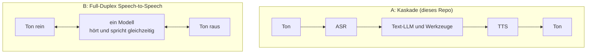
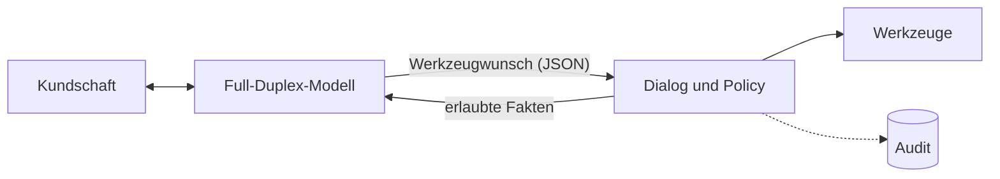

# 14 Full-Duplex-Sprachmodelle: was anders ist

Stand der Quellen: Oktober 2026. Nichts in diesem Dossier ist im Repo getestet.

## Drei Bauarten

Dazwischen liegen Realtime-APIs von Cloud-Anbietern, die Audio direkt verarbeiten, intern
aber auf einem Text-Sprachmodell mit Werkzeugen aufbauen.

| | Kaskade | Full-Duplex |
|---|---|---|
| Sprecherwechsel | nachgebaut mit Endpointing und Barge-in | im Modell |
| Ton und Emotion der Kundschaft | gehen im Text weitgehend verloren | bleiben erhalten |
| Fakten und Werkzeuge | Text-LLM mit Werkzeugen | bei den offenen Modellen unten nicht dokumentiert |
| Prüfen vor dem Sprechen | jeder Satz liegt als Text vor und wird geprüft | kein Text, den man vorher prüfen kann |
| Sprachen | hängt von ASR, LLM und TTS ab | PersonaPlex laut Modellkarte nur Englisch |

## Zwei Beispiele

**PersonaPlex (NVIDIA)**, veröffentlicht am 15. Januar 2026: laut Modellkarte 7 Mrd.
Parameter, aufgebaut auf Moshi (Kyutai), Gewichte unter der NVIDIA Open Model License,
Englisch. Die Karte nennt für FullDuplexBench eine Latenz von 0.170 beim Sprecherwechsel und
0.240 beim Unterbrechen (ohne Einheit; vermutlich Sekunden). Werkzeugaufrufe erwähnt sie
nicht.

**Dessa (Block)**, vorgestellt im Oktober 2026, laut TechCrunch ohne öffentlichen Zugang.
Nach Angaben von Block ein Full-Duplex-Modell, trainiert auf menschlicher Sprache mit einem
einzelnen GPU-Rack, lokal lauffähig auf einem Rechner wie einem MacBook mit M4 Max. Block lässt
das Modell von Sicherheitsforschenden prüfen. Zu Grösse, Lizenz, Sprachen und Messwerten gibt
es keine Angaben.

## Was die Kaskade davon übernimmt

| Eigenschaft | Umsetzung in diesem Repo | Datei |
|---|---|---|
| erkennt, wann jemand fertig ist | Endpointing mit Satzende-Schätzung | `turn.py` |
| lässt sich unterbrechen | Barge-in: Wiedergabe kappen, Genesys informieren, Verlauf auf das Gesagte kürzen | `pipeline.py` |
| ignoriert Rückmeldelaute | «mhm» und «genau» unterbrechen nicht | `turn.py` |
| antwortet früh | Satz-Streaming, Prefix Caching, Denkmodus aus | `gateway.py`, `deploy/` |

## Wo ein Full-Duplex-Modell andocken könnte

Ein solches Modell würde ASR, TTS und Gesprächsfluss ersetzen, nicht Policy, Werkzeuge und
Audit. Das setzt voraus, dass es Werkzeugaufrufe oder ein mitlaufendes Transkript liefert;
sonst gibt es nichts zu prüfen und nichts zu protokollieren.

Bedingungen für einen Einsatz im Kundendienst:

1. Gewichte und Lizenz erlauben den Betrieb im eigenen Rechenzentrum.
2. Deutsch in Telefonqualität, je nach Kundschaft auch Schweizerdeutsch.
3. Werkzeugaufrufe oder Transkript in Echtzeit.
4. Dasselbe Golden-Set (`evals/`) besteht das Gate.
5. Der Agent gibt sich als KI zu erkennen; je menschlicher die Stimme, desto wichtiger.

## Grenzen

- Alle Angaben stammen aus Modellkarten und Presseberichten mit unterschiedlicher
  Messmethode.
- Keine eigene Messung.

## Kritische Fragen

| # | Frage | Warum |
|---|---|---|
| 1 | Zählt im eigenen Kundendienst eher die Stimme oder die richtige Auskunft? | Bestimmt, ob ein Full-Duplex-Modell einen Vorteil bringt. |
| 2 | Lässt sich ohne Text-Transkript prüfen und protokollieren? | Ohne Prüfung keine Leitplanken. |
| 3 | Wie reagiert die Kundschaft auf eine sehr menschliche KI-Stimme? | Vertrauen und Transparenzpflichten. |

## Quellen

- NVIDIA, Modellkarte PersonaPlex-7B-v1, https://huggingface.co/nvidia/personaplex-7b-v1
- TechCrunch, «Block's new voice model sounds eerily human», 24.10.2026,
  https://techcrunch.com/2026/10/24/blocks-new-voice-model-sounds-eerily-human/
- A. Défossez et al., «Moshi: a speech-text foundation model for real-time dialogue»,
  arXiv:2410.00037
