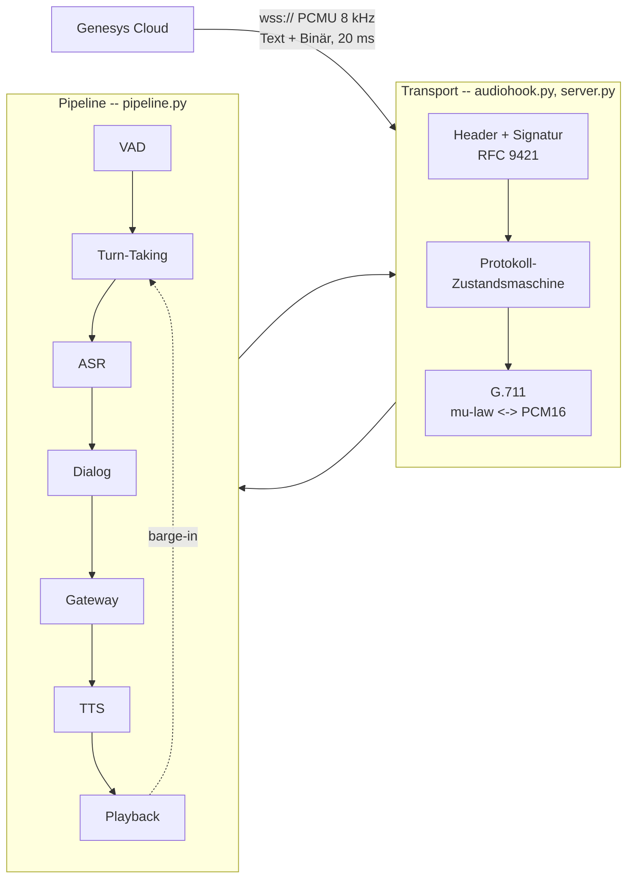
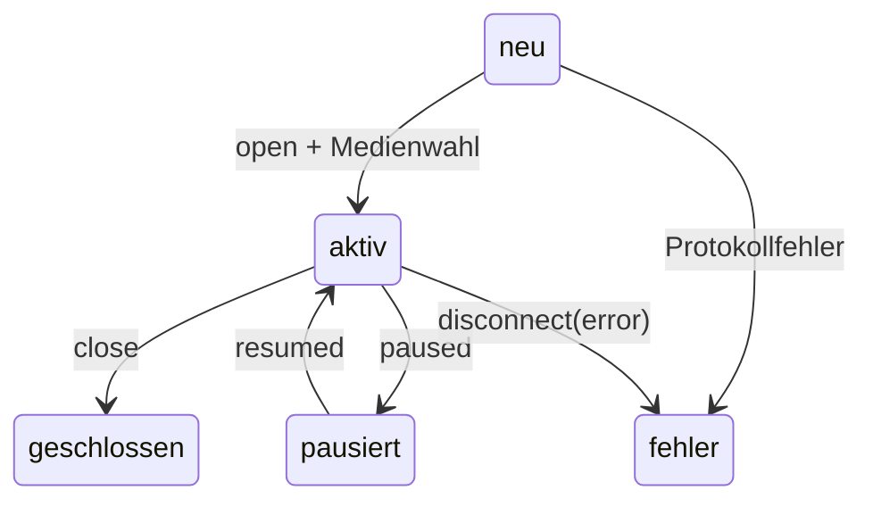

# 17 Telefonie und Streaming: Code des Audio-Transports und der Pipeline

Dieses Dossier zeigt, **wie** der Ton vom Telefon bis zum Antwortwort durch den
Code laeuft -- und wo in den Modulen jeweils etwas passiert. Es ist bewusst
code-nah geschrieben: jede Aussage nennt das Modul und die Funktion, und kurze
Auszuge zeigen den entscheidenden Teil. Der Volltext der Module ist massgebend;
ein Auszug ist nur eine Wegmarkierung.

Es ergaenzt [`01-architektur.md`](01-architektur.md) (Datenfluss auf hoher
Ebene), [`14-dessa-und-full-duplex.md`](14-dessa-und-full-duplex.md) (Kaskade
gegen Full-Duplex-Modelle) und [`15-latenz.md`](15-latenz.md) (Latenzbudget,
Simulation, Messung). Dieses Dossier sagt nichts ueber Latenz ausser wo sie
entsteht; Zahlen stehen in [15](15-latenz.md).

## In English

A voice agent that plugs into Genesys Cloud through the Audio Connector
(WebSocket, PCMU 8 kHz, 20 ms frames), with semantic endpointing, barge-in, a
sentence-streaming LLM gateway, and a tamper-evident audit chain. This page walks
the code of two layers a telephony reader needs: the **transport**
(`audio.py`, `audiohook.py`, `signatur.py`, `server.py`) and the **streaming
pipeline** (`vad.py`, `turn.py`, `pipeline.py`). Every claim points to a module
and function; short excerpts mark the spot, the full module is authoritative.
All code runs offline against mocks; no GPU and no secrets are needed.

## Uebersicht

Zwei Schichten, eine Kette. Der Transport bringt Audio rein und raus und haelt
das Genesys-Protokoll; die Pipeline entscheidet pro 20-ms-Frame, was zu hoeren
ist, wann die Kundschaft fertig ist, welche Antwort kommt und wann der Bot
unterbrochen wird.



Die drei Stufen, die die Zeit bis zum ersten Ton kurz halten, sitzen in
`pipeline.py`: semantisches Endpointing, Satz-Streaming und Barge-in.

## 1. Der Transport: Genesys Audio Connector

### 1.1 Verbindung und Header

Genesys Cloud ist der WebSocket-Client, der pro Anruf eine Verbindung zu
`server.py` oeffnet. Ueber derselben Verbindung laufen Text-Frames (JSON-
Steuernachrichten) und Binär-Frames (Audio, PCMU 8 kHz).

Vor dem ersten Frame wird der Upgrade-Request gegen zwei Sachen geprueft:
Pflicht-Header und die Signatur. `audiohook.py:pruefe_header` kontrolliert
`PFLICHT_HEADER` und den API-Key; `signatur.py:pruefe_signatur` prueft
zusätzlich die HTTP-Nachrichtensignatur (Abschnitt 1.5).

```python
# Auszug aus audiohook.py
PFLICHT_HEADER = (
    "audiohook-organization-id",
    "audiohook-correlation-id",
    "audiohook-session-id",
    "x-api-key",
)


def pruefe_header(headers, api_key):
    h = {k.lower(): v for k, v in headers.items()}
    fehlend = [k for k in PFLICHT_HEADER if not h.get(k)]
    if fehlend:
        return f"fehlende Header: {', '.join(fehlend)}"
    if not api_key or not hmac.compare_digest(h["x-api-key"].encode(), api_key.encode()):
        return "API-Key ungültig"
    return None
```

Der API-Key wird mit `hmac.compare_digest` verglichen, weil ein gewoehnlicher
String-Vergleich eine Timing-Seitenkanaele laesst.

### 1.2 Audio: G.711 mu-law (`audio.py`)

Telefonie spricht G.711: 8000 Samples pro Sekunde, 8 Bit pro Sample,
logarithmisch kodiert (mu-law, bei Genesys `PCMU`). Ein Kanal ist damit 64
kbit/s. Modelle dagegen wollen lineares PCM 16 Bit, ASR meist 16 kHz.
`audio.py` uebersetzt dazwischen, mit der Standardbibliothek.

Die zentralen Konstanten (in `audio.py`):

```python
TELEFON_RATE = 8000  # Hz, G.711
ASR_RATE = 16000  # Hz, Whisper und ähnliche
FRAME_MS = 20  # übliche Paketgrösse in RTP und AudioHook
```

Ein 20-ms-Frame bei 8 kHz und 16 Bit ist 320 Byte. `frame_bytes(TELEFON_RATE)`
rechnet das: `8000 * 20 // 1000 * 2 = 320`.

`audioop` (der Standard-Codec) ist in Python 3.13 aus der Standardbibliothek
entfernt. Deshalb implementiert `audio.py` den mu-law-Codec selbst,
bitgleich mit der Sun-Referenz `g711.c` (auf der auch `audioop.lin2ulaw`
aufbaute): das Sample wird arithmetisch auf 14 Bit geschoben, dann nach
Vorzeichen und Betrag kodiert. Kodieren und Dekodieren sind
Tabellenzugriff (`_ULAW_ENCODE`, `_ULAW_DECODE`), damit 64 kbit/s ohne
Rechenlast laufen.

```python
# Auszug aus audio.py -- ein Sample, nach g711.c
def _lin2ulaw(sample: int) -> int:
    wert = sample >> 2
    if wert < 0:
        wert, maske = -wert, 0x7F
    else:
        maske = 0xFF
    wert = min(wert, _CLIP_14) + _BIAS_14
    segment = next((i for i, ende in enumerate(_SEG_ENDE_14) if wert <= ende), 8)
    if segment >= 8:
        return 0x7F ^ maske
    return ((segment << 4) | ((wert >> (segment + 1)) & 0x0F)) ^ maske
```

Weitere Bausteine in `audio.py`:

| Funktion | Aufgabe |
|---|---|
| `deinterleave(data, kanaele)` | Verschaenktes L R L R zu je einem Bytes pro Kanal |
| `ulaw_to_pcm16` / `pcm16_to_ulaw` | G.711 in die beiden Richtungen (Tabellenzugriff) |
| `resample_linear` | 8 zu 16 kHz, lineare Interpolation (in Produktion `soxr`) |
| `dbfs` / `rms` | Pegel fuer die VAD |
| `frames` / `frame_bytes` | Zerlegen in 20-ms-Frames |
| `wav_bytes` / `wav_to_pcm` | WAV-Container fuer HTTP-ASR-Endpunkte |

Ein Punkt, der oft uebersehen wird: `deinterleave` haelt die Kanalreihenfolge
der Liste `channels` im gewaehlten Medienformat ein (z. B.
`["external", "internal"]`). Die Reihenfolge ist kein Zufall; sie kommt aus
`audiohook.py:_medien_waehlen` und bestimmt, welcher Kanal die Kundschaft ist
(`external`).

### 1.3 Protokoll-Zustandsmaschine (`audiohook.py`)

`AudioHookSitzung` ist eine Zustandsmaschine, die kein Netzwerk kennt:
Nachrichten rein, Antworten raus. Deshalb laesst sie sich offline gegen Fixtures
testen, und `server.py` bleibt duenn.

Zwei Betriebsarten:

- `connector` (Audio Connector): Sprachagent im Architect-Flow, bidirektional.
  Der Server sendet Audio zurueck und beendet mit `disconnect`; dessen
  `outputVariables` (String-Werte) landen im Architect-Flow, z. B. Ziel-Queue
  und Ticketnummer.
- `monitor` (AudioHook Monitor): Mithoeren laufender Gespraeche, beide Kaenale
  getrennt, fuer Live-Transkript und Agent-Assist. Kein Rueckkanal.



Protokollregeln (nach der Genesys-Referenzimplementierung,
`github.com/purecloudlabs/audiohook-reference-implementation`):

- Client-Nachrichten tragen `version`, `id`, `type`, `seq`, `serverseq`,
  `position`, `parameters`; Server-Nachrichten `version`, `id`, `type`, `seq`,
  `clientseq`, `parameters` (keine `position`).
- `seq` des Clients muss lueckenlos steigen; `serverseq` darf die eigene `seq`
  nicht uebersteigen; die Sitzungs-`id` darf sich nicht aendern.
- Fehler meldet der Server mit `disconnect` (Grund `completed`, `unauthorized`
  oder `error`), nicht mit `error`.
- `close` beantwortet der Server mit `closed`.

Die Eingabe-Pruefung in `audiohook.py:text_empfangen` ist die erste Verteidigung:
eine Nachricht muss wohlgeformtes JSON sein, `seq` muss auf den letzten folgen,
und der Typ muss unterstuetzt sein. Sonst kommt ein `disconnect(error)`.

```python
# Auszug aus audiohook.py:text_empfangen -- Auszug, nicht der ganze Handler
if seq != self.client_seq + 1:
    return self.client_fehler(f"seq {seq} folgt nicht auf {self.client_seq}")
self.client_seq = seq
if serverseq > self.seq:
    return self.client_fehler("serverseq grösser als gesendete seq")
if self.id and m["id"] != self.id:
    return self.client_fehler("Sitzungs-ID hat gewechselt")
```

Audio-Connector-Erweiterungen, die in der Monitor-Referenz nicht vorkommen und
aus der Genesys-Community und oeffentlichen Integrationen stammen (vor
Produktion mit der Genesys AudioHook Test Suite pruefen): `inputVariables` im
`open`, `outputVariables` im `disconnect`, die Ereignis-Entitaet `barge_in`,
und die Client-Nachrichten `dtmf`, `playback_started`, `playback_completed`.

### 1.4 DTMF, Playback und Barge-in

Ziffern vom Tastenfeld kommen als Client-Nachricht `dtmf`.
`audiohook.py:_on_dtmf` sammelt nur gueltige Ziffern (0-9, `*`, `#`) in
`self.dtmf`; ein falsches Format landet nicht im Satz, sondern wird ignoriert.
`playback_started`/`playback_completed` sind Bestaetigungen des Clients fuer
gesendetes Audio; die Klasse meldet nichts zurueck, haelt sie aber im
Protokoll.

Barge-in ist die Unterbrechung. Wenn die Kundschaft in die Ansage des Bots
hineinspricht, verwirft der Bot den noch nicht gesendeten Rest und meldet
Genesys ein `barge_in`-Ereignis. `audiohook.py:barge_in` liefert die Nachricht:

```python
def barge_in(self) -> Nachricht:
    return self._msg("event", {"entities": [{"type": "barge_in", "data": {}}]})
```

Die Uebertragung an einen Menschen ist `beenden`: ein `disconnect` mit
`outputVariables`, dessen Werte alle Strings sind (AudioHook akzeptiert nur
Strings im Architect-Flow).

### 1.5 Sicherheit: Signatur nach RFC 9421 (`signatur.py`)

Beim Verbindungsaufbau signiert Genesys den WebSocket-Upgrade nach HTTP
Message Signatures (IETF, heute RFC 9421) mit HMAC-SHA256. Schluessel ist das
Client Secret (Base64), `keyid` ist der API-Key. Signiert werden mindestens
`@request-target`, `@authority`, `audiohook-organization-id`,
`audiohook-session-id`, `audiohook-correlation-id`, `x-api-key`.

`signatur.py:pruefe_signatur` fuegt zur Referenz zwei Dinge hinzu:

- Jede `nonce` wird innerhalb ihres Gueltigkeitsfensters nur einmal akzeptiert
  (Schutz gegen Wiedereinspielen; `NonceSpeicher`).
- Bei einem unbekannten `keyid` wird mit einem Zufallsschluessel
  weitergerechnet, damit die Antwortzeit nichts ueber den Schluessel verraeft.

Zeitfenster (in `signatur.py`): `created` darf nicht in der Zukunft liegen
(3 s Toleranz), Hoechstalter `MAX_ALTER_S = 10` s, `expires` wird beachtet,
`nonce` mindestens `MIN_NONCE_LAENGE = 22` Zeichen. Der Parser deckt die
noetige Teilmenge von RFC 8941 (Structured Field Values) ab: Dictionary,
Inner List, Parameter, String, Token, Integer, Boolean, Byte Sequence. Die
Tests vergleichen gegen die Testvektoren der Genesys-Referenz.

## 2. Die Streaming-Pipeline (`pipeline.py`, `turn.py`, `vad.py`)

Die Pipeline ist synchron und zeitgesteuert ueber `t_ms` der Frames. Im
Simulator laeuft die Uhr simuliert, im Server ist sie echt -- dieselbe Logik,
zwei Uhren. Die Kette:

```text
Frame -> VAD -> Turn-Taking --(Turn-Ende)--> ASR -> Dialog
      -> Gateway (satzweise) -> TTS -> Wiedergabeplan -> Audio raus
                 ^                                    |
                 +----------- (Barge-in: abbrechen) --+
```

### 2.1 Sprachaktivitaet: `vad.py`

Die VAD beantwortet eine einzige Frage pro 20-ms-Frame: «Ist hier Sprache?».
Ob jemand fertig ist, entscheidet nicht die VAD, sondern das Turn-Taking
(Abschnitt 2.2). `EnergieVAD` in `vad.py` lernt den Rauschpegel der Leitung
und erkennt Sprache als deutlichen Abstand darueber:

```python
# Auszug aus vad.py:EnergieVAD.ist_sprache
if pegel > max(self.min_pegel_db, self.rauschboden + self.abstand_db):
    self._nachlauf = self.nachlauf_frames
    return True
self.rauschboden += self.anpassung * (pegel - self.rauschboden)
if self._nachlauf > 0:
    self._nachlauf -= 1
    return True
return False
```

Die Konstanten (in `vad.py`): `abstand_db = 12.0`, `min_pegel_db = -45.0`,
`nachlauf_frames = 3` (60 ms «Hangover» gegen Abhacken), `anpassung = 0.05`.
Der Rauschboden wird nur in Pausen nachgefhrt, nie waehrend Sprache. Gegen
Straassenlaerm und Wartemusik ist ein neuronales Modell robuster
(`adapters/silero.py`, Schnittstelle `VAD`).

### 2.2 Turn-Taking und semantisches Endpointing (`turn.py`)

Die klassische Loesung wartet eine feste Stille ab (oft 700-800 ms). Dann wirkt
der Bot traege, und wer beim Diktieren einer Nummer kurz Luft holt, wird
abgeschnitten. `turn.py` macht das Endpointing *semantisch*: die Wartezeit
haengt davon ab, ob der erkannte Text wie ein fertiger Satz aussieht.

```python
# Auszug aus turn.py -- die Wahrscheinlichkeit, dass ein Satz fertig ist
def satzende_wahrscheinlichkeit(text: str) -> float:
    t = text.strip()
    if t[-1] in ".?!":
        return 0.9
    woerter = re.findall(r"[\wäöüÄÖÜ]+", t.lower())
    letzt = woerter[-1]
    if letzt in _FUELLER_UND_BINDEWOERTER:
        return 0.1  # "und", "aber", "dass" -> weiter
    if letzt.isdigit() and _NUMMER_KONTEXT.search(t):
        return 0.3  # Nummern werden in Gruppen diktiert
    if woerter[0] in _FRAGEWOERTER and len(woerter) >= 3:
        return 0.75
    return 0.6
```

`TurnTaking.frame(ist_sprache, t_ms, teiltext)` wird pro 20-ms-Frame
aufgerufen und liefert Ereignisse (`TURN_ENDE`, `BARGE_IN`, `BACKCHANNEL`,
`VERWORFEN`). `teiltext` ist das bisherige Zwischenergebnis einer
Streaming-ASR (leer, wenn keine da sind). Die Wartezeit ist eine Interpolation
der Konfiguration (in `turn.py:TurnConfig`):

```python
# Auszug aus turn.py:TurnTaking.frame -- Stille, bis das Ende erkannt ist
warte = c.warte_unfertig_ms - p * (c.warte_unfertig_ms - c.warte_fertig_ms)
if stille >= warte:
    ev.append(self._ende(t_ms, stille, p, "semantisch"))
```

Die Defaults: `min_pause_ms = 200`, `warte_fertig_ms = 200`,
`warte_unfertig_ms = 1200`, `min_sprache_ms = 150`, `barge_in_ms = 300`,
`max_turn_ms = 30000` (Sicherheitsnetz gegen Endlos-Monolog). Die
Wartezeiten sind Konfigurationswerte, keine gemessenen Optima; sie gehoeren pro
Projekt mit echten Aufnahmen kalibriert.

Rueckmeldelaute wie «mhm» oder «genau» sind Backchannel, keine Unterbrechung.
`ist_backchannel` erkennt sie; der Bot spricht weiter. Ein Modell steckt man
ueber `semantik=` ein -- dieselbe Idee steckt in Pipecat Smart Turn
(audiobasiert) und im LiveKit Turn Detector (textbasiert); die Heuristik ist ein
Ersatz ohne Abhaengigkeiten.

### 2.3 Satz-Streaming: Gateway und TTS (`pipeline.py`, `gateway.py`)

Die Antwort kommt satzweise. `gateway.py:LLMGateway` liest den
Stream des Modells und liefert den ersten geprueften Satz sofort, waehrend das
Modell weiterschreibt. `pipeline.py` baut daraus einen
Wiedergabeplan (`Wiedergabe(start_ms, ende_ms, text)`) und die
Sprachausgabe beginnt mit Satz 1. Zwei weitere Techniken, die in
`pipeline.py` sitzen: `VORLAUF_MS = 200` (Audio vor dem Sprachbeginn wird
mitschickt, damit die erste Silbe nicht fehlt), und `NOTFALL_TEXT` (bei einem
Ausfall uebergibt der Agent an einen Menschen, statt in Stille zu verfallen).

Ein Punkt, der die Latenz praeget: `pipeline.py` erwartet von der ASR
`teiltext` pro Frame. Liefert die ASR nur das fertige Transkript (der
mitgelieferte HTTP-Adapter), wartet das Endpointing ohne Text laenger --
die Simulation in [15](15-latenz.md) zeigt, wie viel das kostet. Das ist der
Hauptgrund, warum ein Streaming-ASR-Adapter in der [ROADMAP](../ROADMAP.md)
steht (siehe Abschnitt 4).

### 2.4 Barge-in: der Mechanismus (`server.py`)

Der Server ist duenn: Netzwerk rein, Protokoll und Pipeline, Netzwerk raus. Pro
Anruf laufen drei Aufgaben nebeneinander (`server.py:sitzung`):

- **Empfang**: Steuernachrichten sofort beantworten, Audio in eine
  Warteschlange legen. Blockiert nie.
- **Verarbeitung**: die Pipeline in einem eigenen Thread pro Gespraech
  (`ThreadPoolExecutor(max_workers=1)`), damit ein langsamer Modellaufruf
  weder andere Anrufe noch Pings haelt.
- **Senden**: Bot-Audio in 20-ms-Frames gegen feste Fristen. Barge-in verwirft
  alle noch nicht gesendeten Frames sofort.

Die Verarbeitung laeuft im Thread, die Sendung im Event-Loop; die Bruecke ist
`loop.call_soon_threadsafe`. Ein Barge-in kommt als Ereignis aus dem
Verarbeitungsthread zurueck, fuehrt `ton_raus.clear()` aus und meldet
Genesys `barge_in`:

```python
# Auszug aus server.py:sitzung -- Barge-in aus dem Verarbeitungsthread
def _barge():
    ton_raus.clear()
    steuer_raus.put_nowait(ah.barge_in())
```

Ein Thread pro Anruf ist einfach und korrekt fuer einen Einzellaeufer; fuer
viele Anrufe ist es ein Engpass (ein Prozess mit N Anrufen braucht N Threads,
und `max_sitzungen` ist ein harter Cap, keine Warteschlange). Das steht in
[`../BOTTLENECKS.md`](../BOTTLENECKS.md) (Abschnitt 2.2) und in der
[ROADMAP](../ROADMAP.md).

### 2.5 Telemetrie

Jeder Austausch laesst Spans in `telemetry.py` (p50/p95 je Stufe gegen das
Zielbudget) und im Prometheus-Format ueber `/metrics`. Der Server haengt
`gw_contactcenter_aktive_sitzungen` an. Zahlen, Simulation und Messung
steht in [15](15-latenz.md).

## 3. Code-Karte

| Baustein | Modul | Schnittstelle | Was dort passiert |
|---|---|---|---|
| Header + Signatur | `audiohook.py`, `signatur.py` | `pruefe_header`, `pruefe_signatur` | Upgrade gegen Pflicht-Header und RFC 9421 |
| G.711 Audio | `audio.py` | `ulaw_to_pcm16`, `pcm16_to_ulaw`, `resample_linear` | 8 kHz mu-law zu 16 kHz PCM, 20-ms-Frames |
| Protokoll | `audiohook.py` | `AudioHookSitzung.text_empfangen`, `audio_empfangen` | Zustandsmaschine, Sequenz- und ID-Pruefung |
| VAD | `vad.py`, `adapters/silero.py` | `VAD.ist_sprache` | Sprache oder Stille pro Frame |
| Turn-Taking | `turn.py` | `TurnTaking.frame`, `satzende_wahrscheinlichkeit` | semantisches Endpointing, Barge-in, Backchannel |
| Pipeline | `pipeline.py` | `Pipeline.frame` | Kette VAD bis Audio, Satz-Streaming, Barge-in |
| Server | `server.py` | `sitzung`, `bedienen` | ein Thread pro Anruf, drei Aufgaben, Metriken |
| Gateway | `gateway.py` | `LLMGateway` | Datenresidenz, Antwortpruefung, Fallback, Budget |
| Audit | `audit.py` | `AuditLog` | HMAC-Hash-Kette, pseudonymisiert |

Grundsatz (aus [01](01-architektur.md)): Ein Weg zu jedem Modell (nur das
Gateway), kein Schreibzugriff ohne Werkzeug, Klassifikation zuerst lokal,
Ausfall heisst Uebergabe, jede Entscheidung landet pseudonymisiert im Audit.

## 4. Wo der Code hinfuehrt

Diese offenen Punkte stehen in der [ROADMAP](../ROADMAP.md); sie sind die
nächsten Schritte, damit der Code in Produktion laeuft.

- **Streaming-ASR-Adapter** mit Zwischenergebnissen. Ohne ihn wartet das
  Endpointing ohne Text, und die Simulation verfehlt das Latenzbudget
  ([15](15-latenz.md)). Hoehste Wirkung, siehe Abschnitt 2.3.
- **SIP-Adapter** fuer Telefonanlagen ohne Genesys. Die Protokollregeln in
  `audiohook.py` sind auf Audio Connector zugeordnet; ein SIP-Trunk braucht
  eine andere Signalisierung (SIP/RTP statt WebSocket/PCMU) und den selben
  Pipeline-Kern.
- **Neurales VAD** (`adapters/silero.py`) statt der Energie-VAD fuer
  laermige Leitungen.
- **Modell-basiertes Endpointing** ueber `turn.py:TurnTaking(semantik=...)`,
  statt der Heuristik.
- **Pruefung gegen die Genesys AudioHook Test Suite**, fuer
  `inputVariables`, `outputVariables`, `barge_in`, `dtmf`, `playback_*`.
- **Backpressure statt hartem Cap** in `server.py` (siehe
  [`../BOTTLENECKS.md`](../BOTTLENECKS.md) 2.2).

## Grenzen

- Die Audio-Connector-Erweiterungen (`barge_in`, `dtmf`, `playback_*`,
  `inputVariables`, `outputVariables`) sind aus der Genesys-Community und
  oeffentlichen Integrationen uebernommen und nicht gegen die Genesys AudioHook
  Test Suite geprueft.
- Die Heuristik in `turn.py` ist ein Ersatz fuer ein Modell; ohne echte
  Aufnahmen kalibriert ist sie nicht optimiert.
- Die Energie-VAD ist gegen Strassenlaerm und Wartemusik schwach; in
  Produktion `adapters/silero.py`.
- Die Signatur-Pruefung deckt die noetige Teilmenge von RFC 8941 ab, nicht
  die gesamte Spezifikation.
- Kein SIP-Trunk, kein zweiter Telephonie-Kanal im Repo.

## Kritische Fragen

| # | Frage | Warum |
|---|---|---|
| 1 | Wird das Repo gegen die Genesys AudioHook Test Suite geprueft? | Ohne die sind die Audio-Connector-Erweiterungen unbestaetigt. |
| 2 | Liefert die ASR Zwischenergebnisse (Streaming)? | Bestimmt die Latenz bis zum ersten Ton (Abschnitt 2.3, [15](15-latenz.md)). |
| 3 | Ist ein SIP-Adapter noetig, oder bleibt alles bei Genesys? | Bestimmt, ob die Protokollschicht erweitert wird. |
| 4 | Wie viele gleichzeitige Anrufe, und wie skaliert der Server? | Ein Thread pro Anruf (Abschnitt 2.4) ist kein Horizontalskalierer. |
| 5 | Welches VAD und welches Endpointing in der Zielumgebung? | Energie gegen Silero, Heuristik gegen Modell. |

## Quellen

- Genesys AudioHook-Referenzimplementierung,
  `github.com/purecloudlabs/audiohook-reference-implementation`
  (`app/audiohook/src/protocol/message.ts`,
  `app/audiohook/src/server/serversessionimpl.ts`, `.../httpsignature`).
- RFC 9421, HTTP Message Signatures; RFC 8941, Structured Field Values.
- ITU-T G.711; Sun-Referenz `g711.c` (Basis von `audioop.lin2ulaw`).
- Pipecat Smart Turn; LiveKit Turn Detector (Eigenschaft in `turn.py`).
- Eigener Code: `audio.py`, `audiohook.py`, `signatur.py`, `turn.py`,
  `vad.py`, `pipeline.py`, `server.py` (Paket `gw_contactcenter`).
